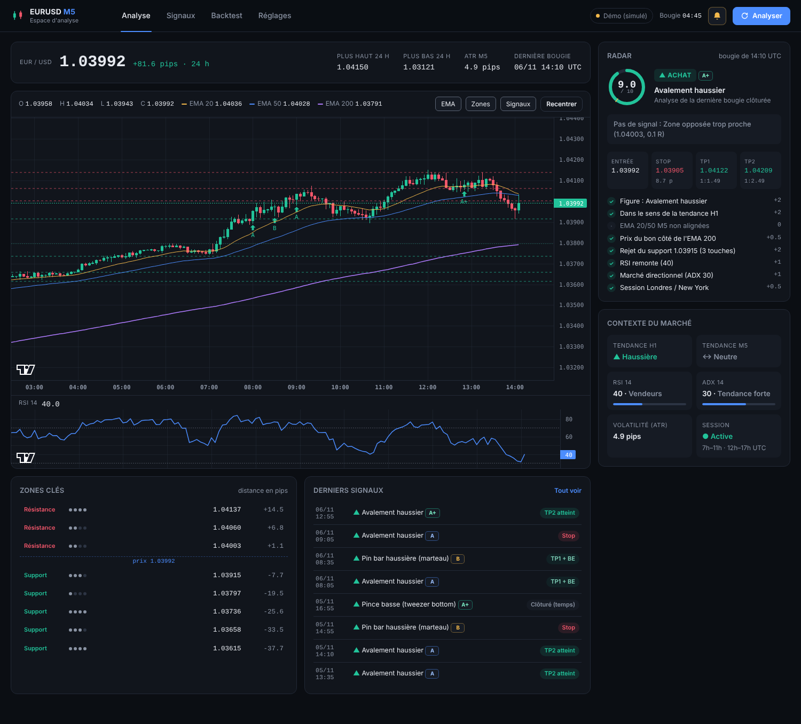
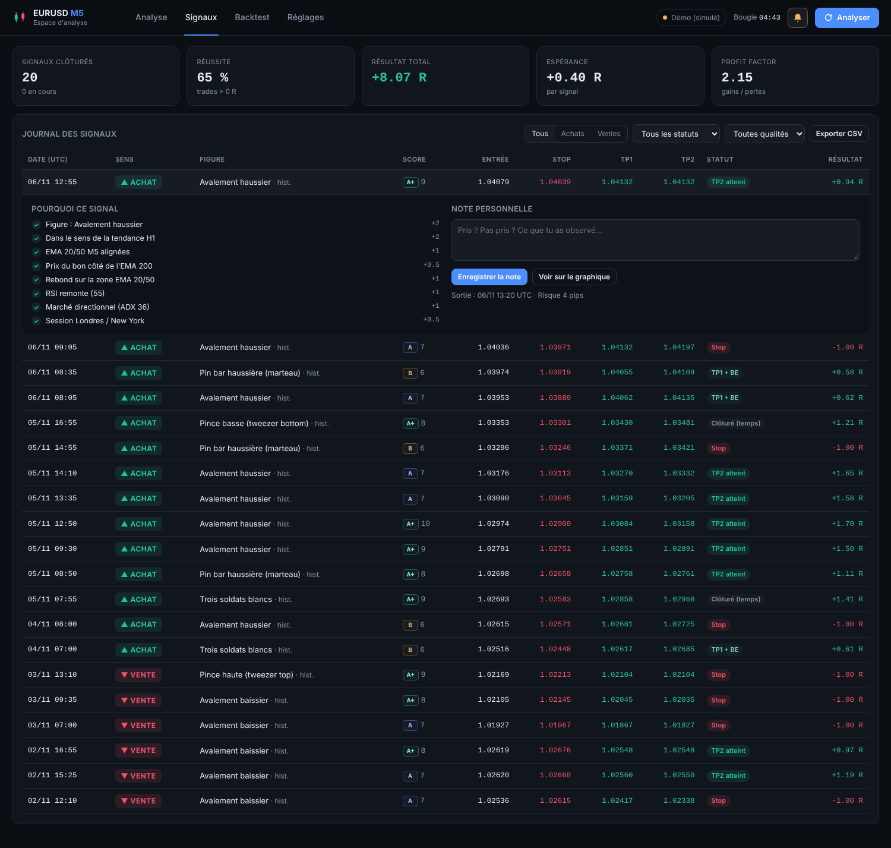
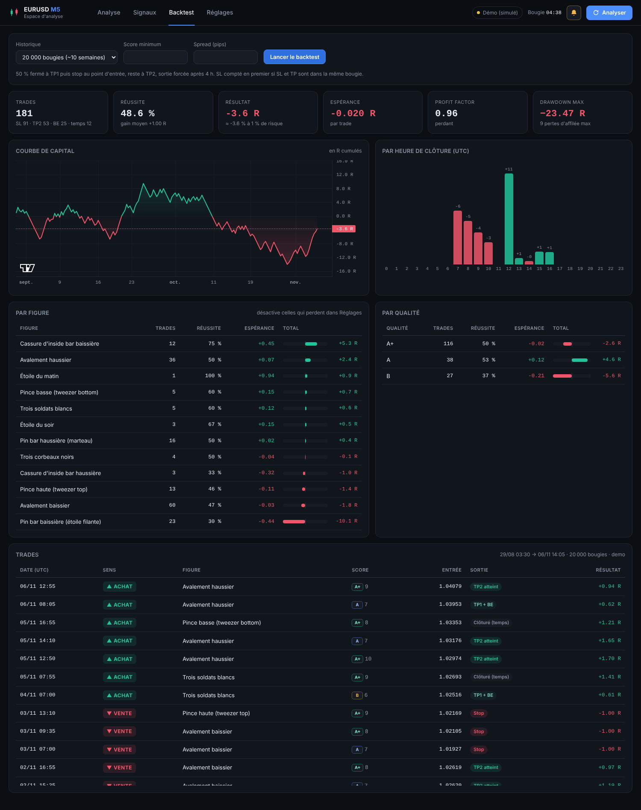

# EURUSD M5 Analyzer

**Espace d'analyse de l'EURUSD en M5** basé sur les chandeliers japonais : graphique en direct,
radar qui note chaque bougie sur 10 et explique pourquoi, zones de support/résistance, journal
qui suit automatiquement le résultat de chaque signal, backtest complet. Les alertes arrivent dans
le **navigateur** (son + notification) et dans le **terminal**.



📘 **[Guide d'utilisation complet (PDF, 24 pages)](docs/Guide_EURUSD_M5_Analyzer.pdf)** — installation, chaque écran, la méthode, les réglages, la routine de trading et le dépannage.

> ⚠️ Outil d'aide à la décision, pas un robot de trading. Aucune stratégie ne gagne à tous les
> coups : vérifie le backtest sur **tes** données MT5, passe par un **compte démo**, et ne risque
> jamais plus de 1 % du capital par trade.

---

## Démarrage rapide

```bash
git clone https://github.com/ck526438-lgtm/eurusd-m5-analyzer.git
cd eurusd-m5-analyzer
pip install -r requirements.txt
pip install MetaTrader5          # Windows : prix temps réel de ton courtier

python main.py                   # ouvre l'espace d'analyse sur http://localhost:8000
python main.py --demo            # pour découvrir l'interface sans MT5 (marché simulé)
```

Sous Windows : double-clique sur **`start.bat`** (installe tout la première fois, puis lance).
Garde MetaTrader 5 ouvert et connecté à ton compte.

---

## Ce que contient l'espace

### Analyse
- **Graphique** chandeliers M5 (600 bougies) avec EMA 20/50/200, zones S/R, flèches des signaux
  passés (cliquables) et niveaux Entrée / SL / TP1 / TP2 du signal en cours ; **RSI** synchronisé.
- **Radar** : la dernière bougie clôturée est analysée et notée sur 10, critère par critère
  (✓ / ✕ avec les points). S'il n'y a pas de signal, il dit **pourquoi** (score trop bas, zone
  opposée trop proche, stop trop large, hors session…).
- **Contexte** : tendance H1 et M5, RSI, ADX, volatilité (ATR), session en cours.
- **Zones clés** classées autour du prix, avec leur solidité (nombre de touches) et la distance en pips.

### Signaux
Journal de tous les signaux (SQLite) avec **suivi automatique** : en cours, TP2 atteint,
TP1 puis BE, stop, clôturé au temps — et le résultat en R. Filtres, détail du score, **note
personnelle** par signal, export CSV.



### Backtest
Sur 1 500 à 50 000 bougies : réussite, espérance, profit factor, drawdown, série de pertes,
**courbe de capital**, résultats **par figure**, **par qualité** et **par heure**.



### Réglages
Tout se règle dans l'interface (enregistré dans `config.yaml`) : source des données, score
minimum, filtres, gestion du risque, **figures actives** (désactive celles que le backtest
montre perdantes), notifications.

---

## Notifications

| Où | Quoi |
|---|---|
| **Terminal** | Une ligne de suivi à chaque clôture M5 + un bandeau coloré avec bip à chaque signal |
| **Navigateur** | Son + notification système + toast (cloche en haut à droite) |
| **Windows** (option) | Notification bureau même navigateur fermé — `pip install plyer` puis activer dans Réglages |

Exemple dans le terminal :

```
14:10  EURUSD 1.03992  H1 ▲  RSI 40  ADX 30  ATR 4.9p  │  ACHAT Avalement haussier 9.0/10 — Zone opposée trop proche

 ▲ ACHAT EURUSD  ·  qualité A+  ·  score 9/10
  Avalement haussier  —  bougie clôturée 06/11 14:15 UTC
  Entrée 1.04006   Stop 1.03966 (4.0 pips)   TP1 1.04066 (1:1.5)   TP2 1.04106 (1:2.5)
    ✓ Figure : Avalement haussier  +3
    ✓ Dans le sens de la tendance H1  +2
    ✓ Rejet du support 1.03935 (2 touches)  +2
    ...
```

Mode terminal seul (sans navigateur) : `python main.py watch`.

---

## La méthode

À chaque clôture M5 (+8 s pour laisser le courtier publier la bougie) :

**1. Figures de chandeliers** — avalement, pin bar (marteau / étoile filante), étoile du matin /
du soir, trois soldats / trois corbeaux, pinces (tweezer), cassure d'inside bar. Les
micro-bougies (< 0,6 ATR) sont ignorées.

**2. Score de confluence /10**

| Critère | Points |
|---|---|
| Force de la figure (+1 si plusieurs figures concordent) | 1 à 3 |
| Sens de la tendance **H1** | +2 (−2 si contre) |
| EMA 20/50 M5 alignées · bon côté de l'EMA 200 | +1 · +0,5 |
| Rejet d'une zone S/R (forte si ≥ 2 touches) ou rebond sur les EMA | +1 à +2 |
| RSI qui confirme (pas en excès) | +1 (−1 si excès) |
| ADX ≥ 18 | +1 (−1 sinon) |
| Session Londres / New York | +0,5 |

Qualité : **A+** ≥ 8 · **A** ≥ 7 · **B** ≥ 6 (seuil réglable).

**3. Risque** — stop derrière la mèche + 0,25 ATR (4 à 18 pips), TP1 = 1,5 R, TP2 = 2,5 R ramené
avant la zone opposée ; setup refusé si une zone bloque à moins de 1,2 R.

Aucune donnée future n'est utilisée (bougies clôturées uniquement, tendance H1 prise à la
clôture de l'heure) — c'est vérifié par un test automatique.

---

## Sources de données

| Source | Usage |
|---|---|
| **MetaTrader 5** (recommandé) | Windows, terminal MT5 ouvert. Règle le **symbole** exact (`EURUSD`, `EURUSDm`…) et le **décalage horaire** du serveur (souvent 2 ou 3) |
| Yahoo Finance | Gratuit, partout ; léger retard possible, 60 jours max |
| CSV | Ton propre historique (`time,open,high,low,close` en UTC) |
| Démo | Marché simulé pour découvrir l'interface — **prix non réels** |

`auto` essaie MT5 puis Yahoo.

## Commandes

```bash
python main.py                    # espace d'analyse (navigateur + terminal)
python main.py watch              # terminal uniquement
python main.py scan               # une analyse puis quitte
python main.py backtest --bars 50000
# options : --demo  --source mt5|yfinance|csv  --csv FICHIER  --port 8000  --no-browser  --no-bell
```

API documentée sur `http://localhost:8000/api/docs`.

## Structure

```
analyzer/
  patterns.py    figures de chandeliers
  indicators.py  EMA, RSI, ATR, ADX, tendance H1
  structure.py   pivots et zones S/R
  strategy.py    score de confluence, SL/TP, radar
  backtest.py    simulation des trades
  journal.py     journal SQLite + suivi des résultats
  service.py     boucle d'analyse
  server.py      API FastAPI + flux temps réel
  terminal.py    notifications terminal
  data.py        MT5 / Yahoo / CSV / démo
web/             interface (HTML/CSS/JS, graphiques TradingView Lightweight Charts)
tests/           tests (moteur, anti-lookahead, API)
```

Tests : `pip install -r requirements-dev.txt && python -m pytest -q`

Graphiques : [TradingView Lightweight Charts™](https://www.tradingview.com/lightweight-charts/) (Apache 2.0).
